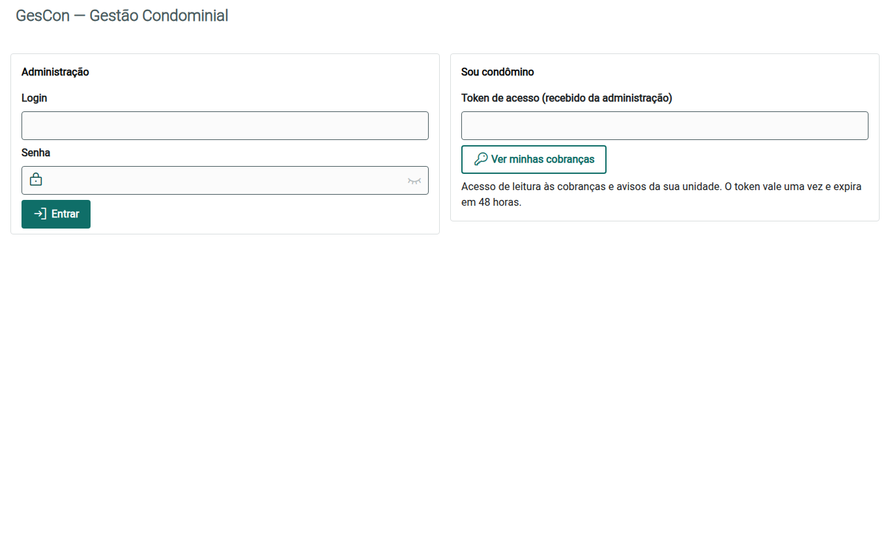
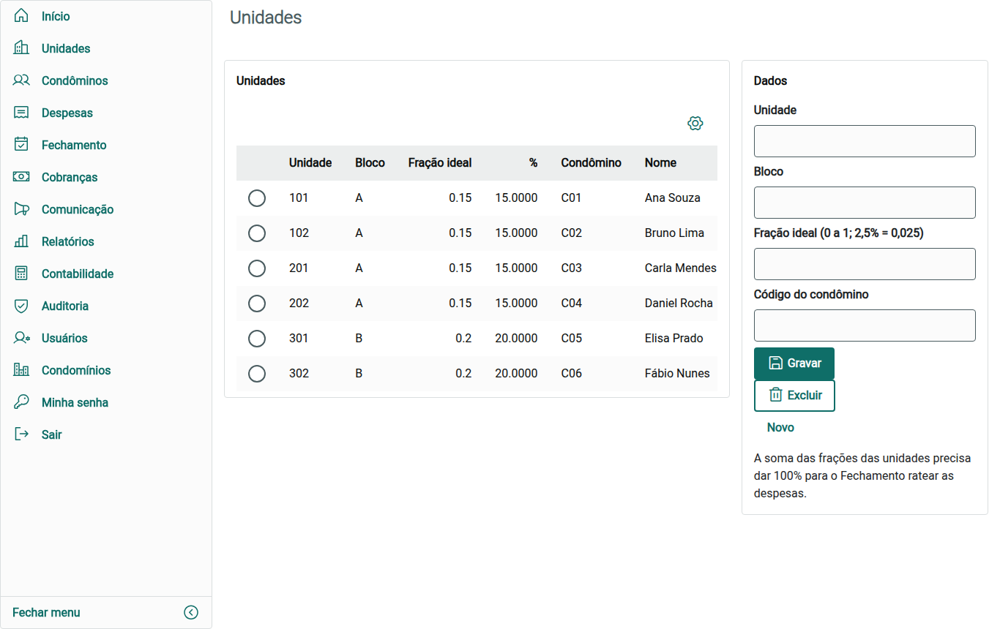
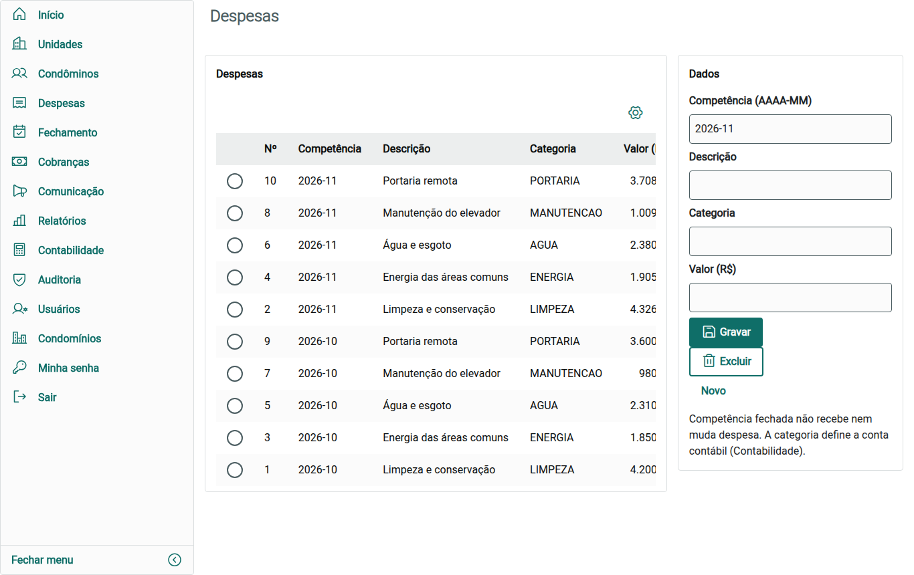
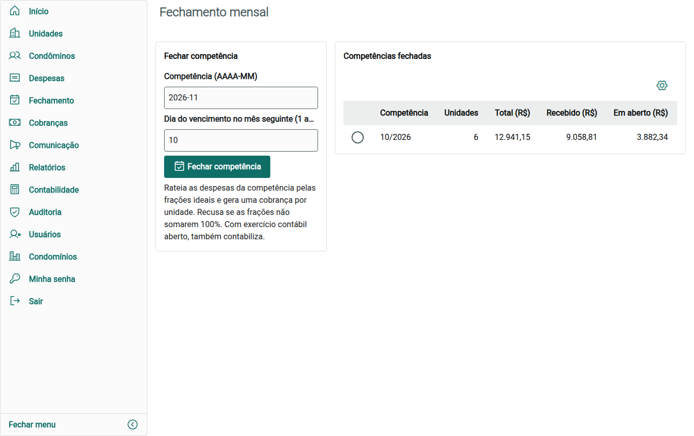
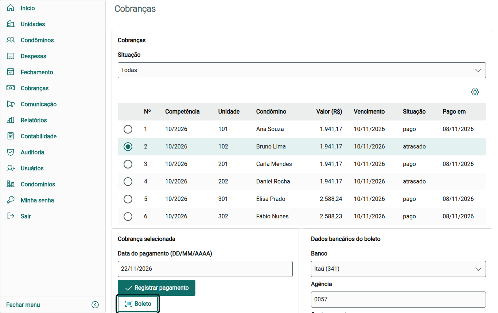
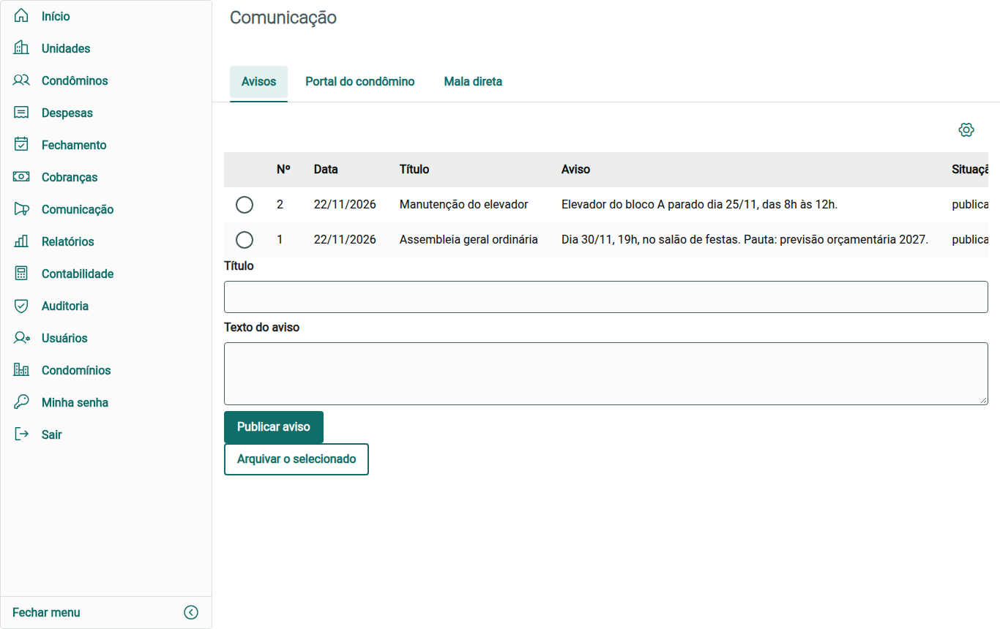
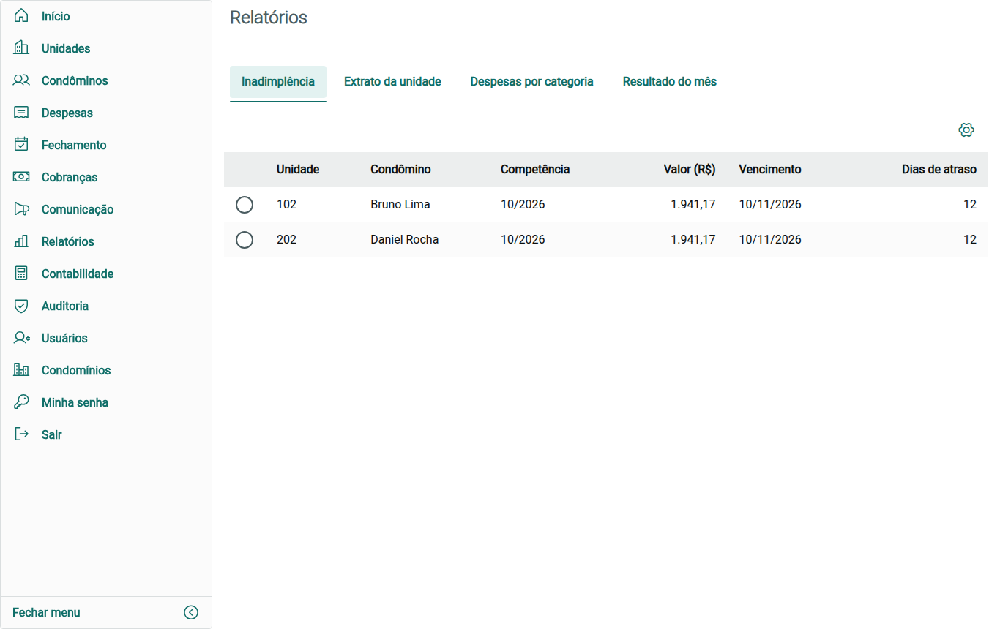
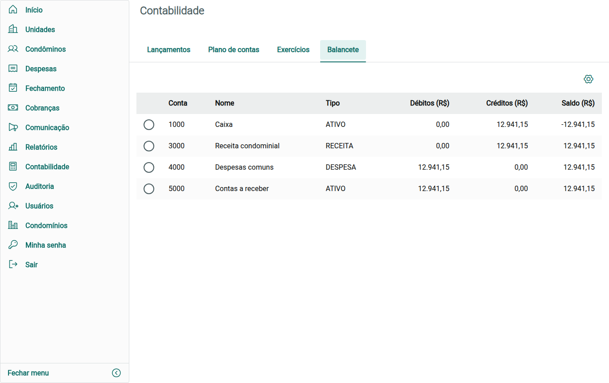
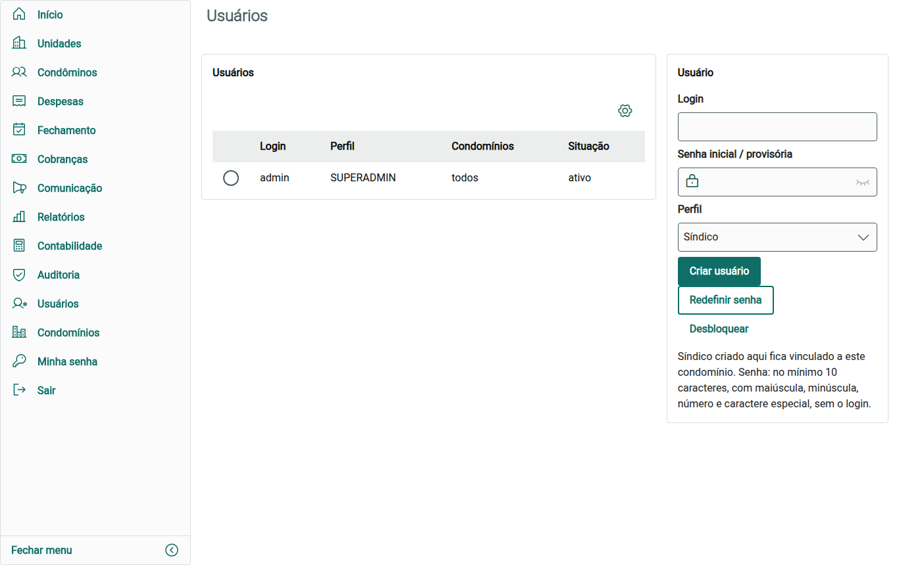
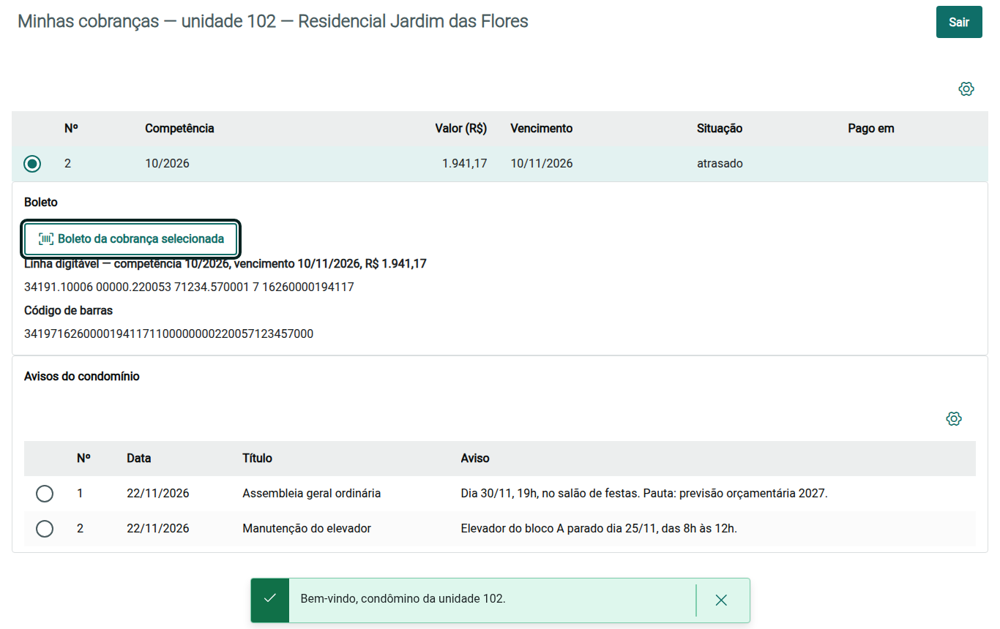

# GesCon — Manual do usuário

## Entrando

A tela de entrada tem duas partes:

- **Administração** — login e senha do super administrador ou do síndico.
- **Sou condômino** — o token recebido da administração (uso único, vale 48
  horas). Abre o portal da unidade, só para leitura.

No primeiro acesso de um usuário, o GesCon pede uma senha nova: no mínimo 10
caracteres, com letra maiúscula, letra minúscula, número e caractere
especial, sem conter o login. Cinco senhas erradas seguidas bloqueiam o
usuário por 15 minutos. Depois de 30 minutos sem uso, a sessão é encerrada:
recarregue a página para entrar de novo.

Quem tem mais de um condomínio escolhe qual abrir; **Trocar condomínio**, no
menu, volta a essa escolha.

## Início

Indicadores do condomínio: unidades, soma das frações ideais (precisa dar
100% para o fechamento), total a receber, total em atraso e despesas do mês,
com o gráfico das despesas do mês por categoria.

## Unidades e condôminos

Clique numa linha da tabela para carregar o registro no formulário à
direita; **Gravar** inclui (código novo) ou altera (código existente),
**Excluir** pede confirmação, **Novo** limpa o formulário.

- Fração ideal: de 0 a 1 (2,5% = 0,025). Aceita vírgula.
- Uma unidade com cobranças não pode ser excluída (é histórico). Um
  condômino vinculado a unidade também não.
- CPF e CNPJ são conferidos pelo dígito verificador, inclusive o CNPJ com
  letras (Receita Federal, a partir de julho de 2026).

## Despesas

Despesa da competência (AAAA-MM), com categoria e valor. A categoria define a
conta contábil. Competência já fechada não recebe nem muda despesa.

## Fechamento

Informe a competência e o dia do vencimento no mês seguinte (1 a 28). O
GesCon soma as despesas da competência, rateia pelas frações ideais (o
centavo que sobrar vai para a unidade de maior fração) e gera uma cobrança
por unidade. Recusa se as frações não somarem 100%. Com um exercício
contábil aberto para a competência, também gera os lançamentos; sem ele,
pergunta se deve seguir só com as cobranças.

A tabela mostra as competências fechadas com total, recebido e em aberto.

## Cobranças

Filtre por situação (em aberto, atrasadas, pagas). Selecione uma cobrança
para:

- **Registrar pagamento** — data no formato DD/MM/AAAA, que exista e não
  seja futura. Cobrança já paga não é regravada.
- **Boleto** — linha digitável e código de barras (padrão FEBRABAN).

Os **dados bancários do boleto** (Itaú ou Bradesco, agência, conta, carteira)
ficam no mesmo lugar e são conferidos pelo layout do banco ao gravar.

## Comunicação

- **Avisos** — publique título e texto; arquive o selecionado. Os avisos
  publicados aparecem no portal do condômino.
- **Portal do condômino** — informe a unidade e emita o token; entregue-o ao
  condômino por um canal seguro. A lista mostra os tokens válidos (sem o
  token em si); **Revogar** cancela os da unidade.
- **Mala direta** — envia por e-mail a cobrança em aberto da competência a
  cada condômino com e-mail cadastrado (o servidor precisa do SMTP
  configurado).

## Relatórios

Inadimplência (com dias de atraso), extrato de uma unidade, despesas por
categoria e resultado do mês (recebido, despesas, saldo e o que ainda está
em aberto).

## Contabilidade

- **Lançamentos** — lançamento manual em partida dobrada (data, histórico,
  conta debitada e creditada pelo código, valor). Se algo impedir, a tela diz
  o motivo. Só lançamentos manuais podem ter o histórico alterado ou ser
  excluídos; os do fechamento ficam como gravados.
- **Plano de contas** — código, nome e tipo (ativo, passivo, receita,
  despesa).
- **Exercícios** — abrir (o novo passa a ser o ativo), validar o equilíbrio
  de débitos e créditos, fechar.
- **Balancete** — por conta, com o saldo pela natureza da conta.

## Auditoria

**Auditar agora** confere o exercício ativo (equilíbrio, lançamentos e
cobranças sem par, rateio, datas fora do período, alterações em período
fechado) e lista anomalias e alertas. **Conferir fechamento do período**
conta as anomalias críticas que impedem fechar o exercício.

## Usuários

- O super administrador cria super administradores e síndicos; o síndico
  cria síndicos do condomínio aberto.
- O login é único (sem diferenciar maiúsculas). O usuário novo troca a senha
  no primeiro acesso.
- **Redefinir senha** define uma senha provisória (troca obrigatória no
  próximo acesso); **Desbloquear** tira o bloqueio por tentativas.

## Condomínios

Só para o super administrador: nome, CNPJ (aceita o alfanumérico) e
endereço. O condomínio novo recebe o próximo código.

## Portal do condômino

Com o token, o condômino vê as cobranças e os avisos da própria unidade e
gera o boleto de uma cobrança em aberto. Não consegue ver nem gerar boleto
de outra unidade.

## Perguntas frequentes

**"A soma das frações ideais das unidades é ... não 100%"** — corrija as
frações em Unidades; o Início mostra a soma atual.

**"Nenhum exercício ativo"** — abra um em Contabilidade > Exercícios.

**"Usuário bloqueado por excesso de tentativas"** — espere 15 minutos ou
peça a um administrador para desbloquear em Usuários.

**Esqueci a senha** — um administrador redefine em Usuários. Se ninguém
consegue entrar, o responsável pelo servidor pode apagar os usuários do
banco e definir `GESCON_ADMIN_SENHA` para recriar o `admin`.
