# GesCon — Manual do Usuário

> Passo a passo de todas as telas do GesCon, para síndicos, administradoras e condôminos.

## Como ler este manual

Todas as figuras são telas reais do GesCon. Em cada uma, uma **moldura
laranja numerada** mostra o menu, o campo ou o botão a usar, e o **balão
escuro** resume a ação. O texto abaixo da figura repete os mesmos números,
na ordem em que você deve fazer.

Os exemplos usam um condomínio de demonstração (Residencial Jardim das
Flores, seis unidades). Nomes, CPFs e valores são fictícios.

### Quem usa o quê

| Perfil | O que pode fazer |
|---|---|
| **Super administrador** | Tudo, em todos os condomínios: cadastra condomínios e cria outros super administradores e síndicos. |
| **Síndico** | Tudo dentro dos condomínios a que tem acesso. Não cadastra condomínio nem cria super administrador. |
| **Condômino** | Entra com um *token* emitido pela administração e só consulta as cobranças, o boleto e os avisos da própria unidade. |

O menu da esquerda mostra apenas as telas que o seu perfil pode usar.

### Sumário

1. Primeiro acesso
2. Entrar no dia a dia, escolher o condomínio e a tela Início
3. Administração: condomínios, usuários e senha
4. Cadastros: condôminos e unidades
5. A rotina do mês: despesas, fechamento, cobranças e boleto
6. Comunicação: avisos, acesso do condômino e mala direta
7. Relatórios
8. Contabilidade e auditoria
9. Reforma tributária: dados fiscais, receitas, teste dos 80% e NFS-e
10. Portal do condômino
11. Roteiros completos
12. Perguntas frequentes e mensagens

---

## 1. Primeiro acesso

Depois de instalar o GesCon (ver o [Guia de utilização](GUIA_UTILIZACAO.md)),
abra o atalho **GesCon**. Na primeira vez, o GesCon abre também o arquivo
**PRIMEIRO-ACESSO.txt**, com a senha inicial do usuário `admin`.

### 1.1 Entrar com a senha inicial

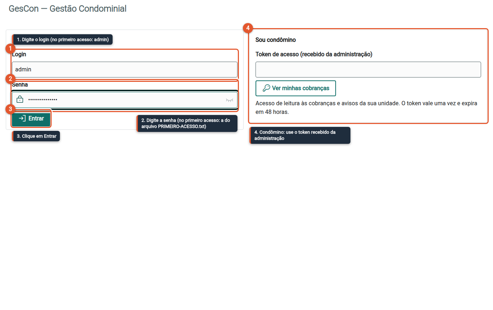

1. Em **Login**, digite `admin`.
2. Em **Senha**, digite a senha do arquivo PRIMEIRO-ACESSO.txt.
3. Clique em **Entrar**.
4. O quadro **Sou condômino** é para os condôminos, que entram com um token
   (seção 10). A administração não usa esse quadro.

### 1.2 Definir a sua senha

No primeiro acesso, e sempre que um administrador redefinir a sua senha, o
GesCon pede uma senha nova antes de qualquer outra coisa.

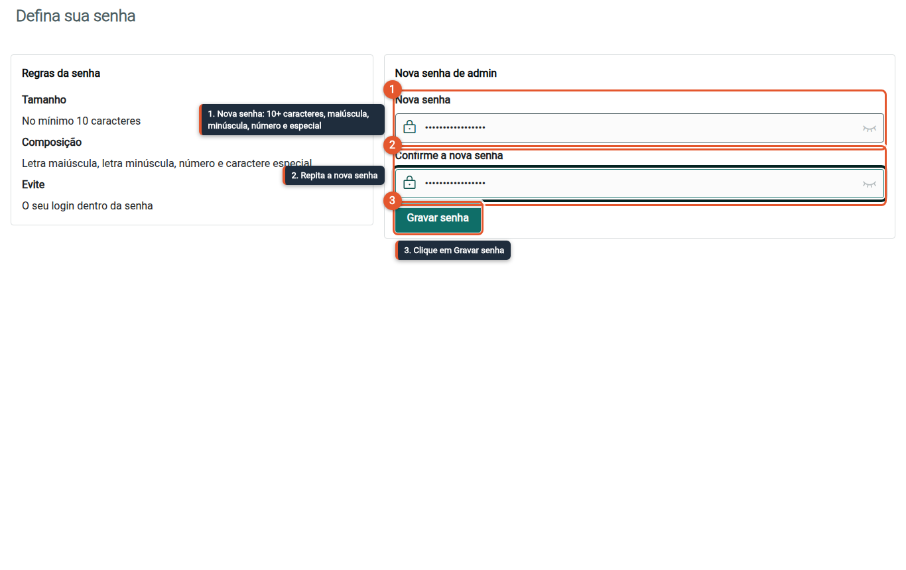

1. Em **Nova senha**, digite uma senha com **no mínimo 10 caracteres**,
   contendo letra maiúscula, letra minúscula, número e caractere especial
   (por exemplo `#`, `@`, `!`). A senha não pode conter o seu login.
2. Em **Confirme a nova senha**, repita a senha.
3. Clique em **Gravar senha**.

Depois disso, **apague o arquivo PRIMEIRO-ACESSO.txt**: a senha inicial
deixou de valer.

---

## 2. Entrar no dia a dia

Na tela de entrada (figura 1.1), informe login e senha e clique em
**Entrar**.

Cuidados com a senha:

- Cinco senhas erradas seguidas **bloqueiam o usuário por 15 minutos**. Um
  administrador pode desbloquear antes, na tela Usuários (seção 3.2).
- Depois de **30 minutos sem uso**, a sessão se encerra sozinha. Recarregue
  a página e entre de novo.

### 2.1 Escolher o condomínio

Quem administra mais de um condomínio escolhe qual abrir.

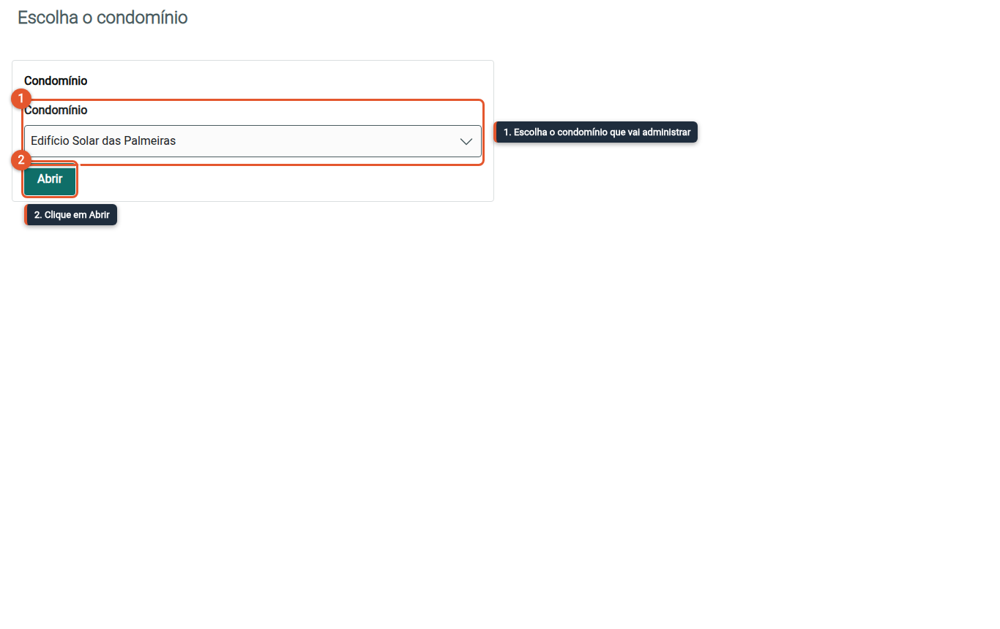

1. Em **Condomínio**, selecione o condomínio.
2. Clique em **Abrir**.

Tudo o que você fizer depois vale só para esse condomínio. Para mudar de
condomínio, use **Trocar condomínio** no menu (seção 3.4).

### 2.2 A tela Início

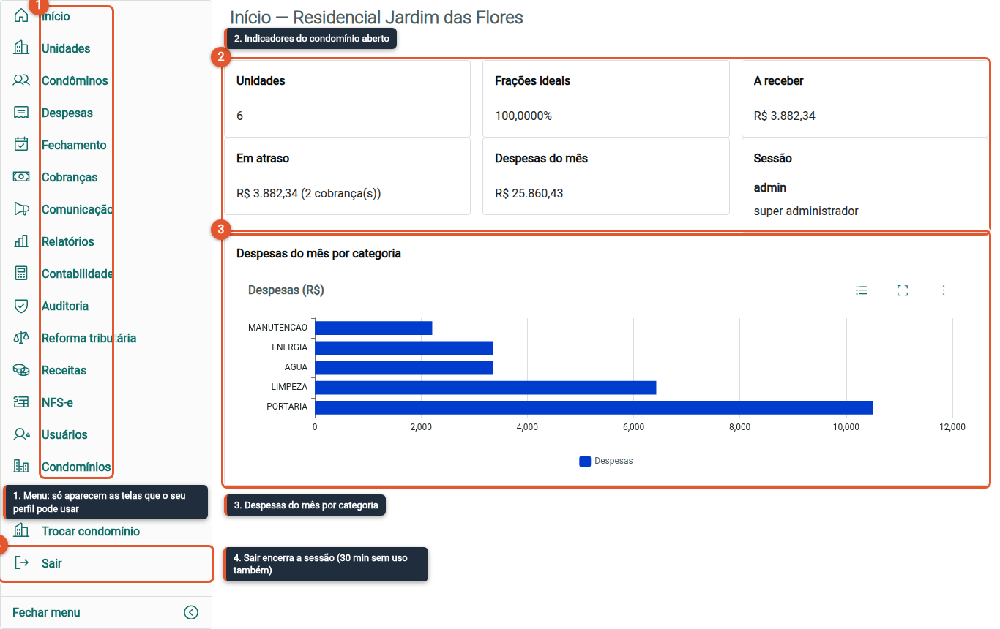

1. **Menu**: dá acesso a todas as telas. O botão **Fechar menu**, no rodapé
   do menu, recolhe o menu para ganhar espaço.
2. **Indicadores** do condomínio aberto: quantidade de unidades, soma das
   frações ideais (precisa dar 100% para o fechamento funcionar), total a
   receber, total em atraso, despesas do mês e o usuário da sessão.
3. **Despesas do mês por categoria**, em gráfico.
4. **Sair** encerra a sessão.

---

## 3. Administração

### 3.1 Condomínios (só super administrador)

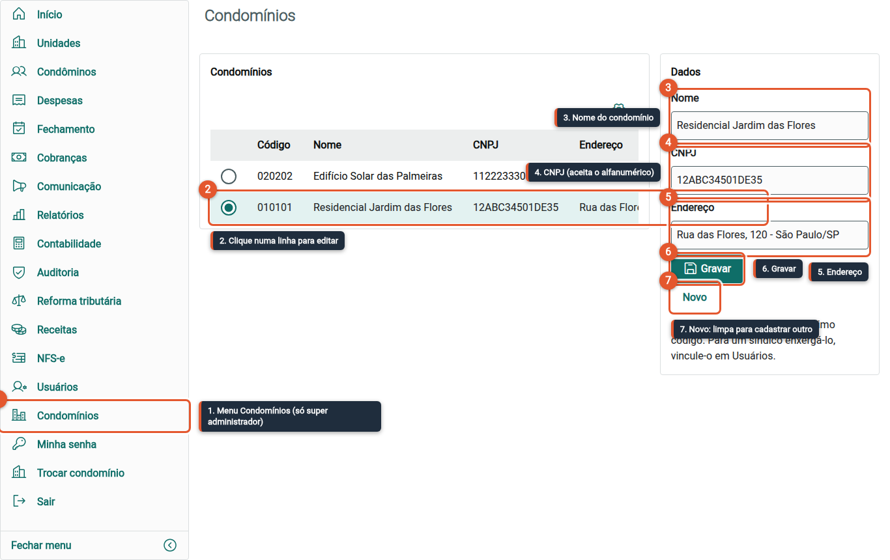

1. No menu, clique em **Condomínios**.
2. Para **alterar** um condomínio, clique na linha dele na tabela: os dados
   vão para o formulário à direita.
3. **Nome**: o nome do condomínio, que aparece no título das telas e no
   portal do condômino.
4. **CNPJ**: o GesCon confere o dígito verificador. Aceita também o CNPJ
   com letras, que a Receita Federal emite a partir de julho de 2026. O
   CNPJ é obrigatório para emitir NFS-e.
5. **Endereço**.
6. Clique em **Gravar**.
7. Para **cadastrar** um condomínio novo, clique em **Novo**, preencha os
   campos e clique em **Gravar**. O condomínio novo recebe um código
   automático.

### 3.2 Usuários

**Criar um usuário**

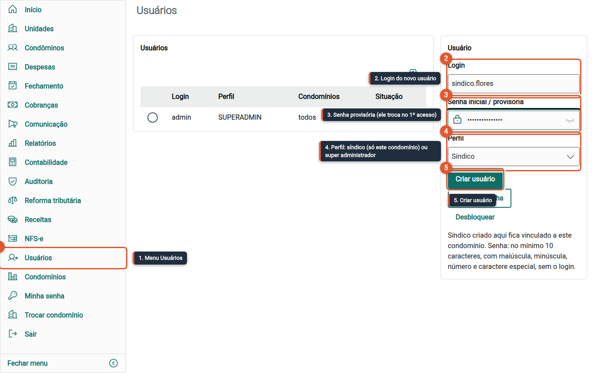

1. No menu, clique em **Usuários**.
2. **Login**: o nome que a pessoa vai digitar ao entrar (sem espaços).
   O GesCon não diferencia maiúsculas de minúsculas no login.
3. **Senha inicial / provisória**: uma senha que siga as regras da seção
   1.2. Entregue-a à pessoa por um canal seguro; ela terá de trocar a senha
   no primeiro acesso.
4. **Perfil**: **Síndico** (acesso ao condomínio aberto) ou **Super
   administrador** (todos os condomínios; só um super administrador pode
   criar outro).
5. Clique em **Criar usuário**.

O GesCon confirma a criação no rodapé da tela:

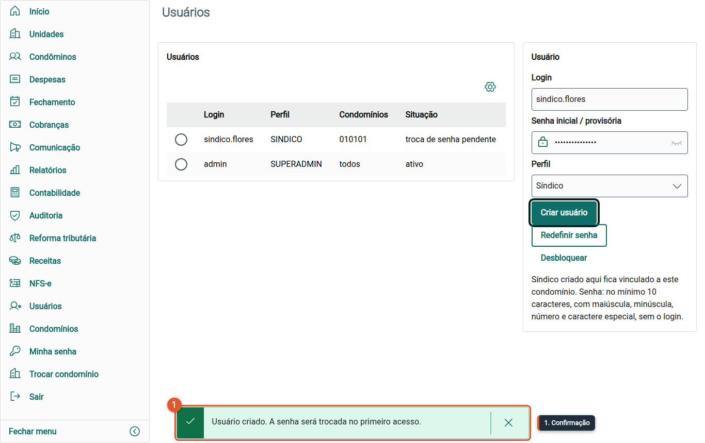

1. Aviso de confirmação. A coluna **Situação** da tabela mostra "troca de
   senha pendente" até a pessoa entrar pela primeira vez.

**Redefinir a senha de alguém ou desbloquear**

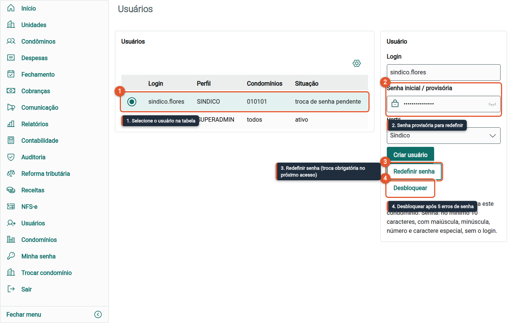

1. Clique no usuário na tabela.
2. Para **redefinir a senha**, digite uma senha provisória.
3. Clique em **Redefinir senha**. A pessoa terá de trocar essa senha no
   próximo acesso.
4. Para liberar um usuário bloqueado por cinco senhas erradas, clique em
   **Desbloquear**.

### 3.3 Minha senha

Qualquer usuário troca a própria senha nesta tela.

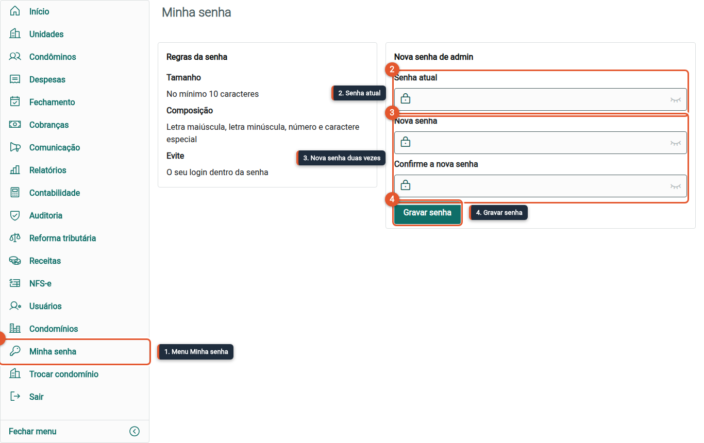

1. No menu, clique em **Minha senha**.
2. **Senha atual**.
3. **Nova senha** e **Confirme a nova senha**. As regras estão escritas à
   esquerda da tela.
4. Clique em **Gravar senha**.

### 3.4 Trocar de condomínio e sair

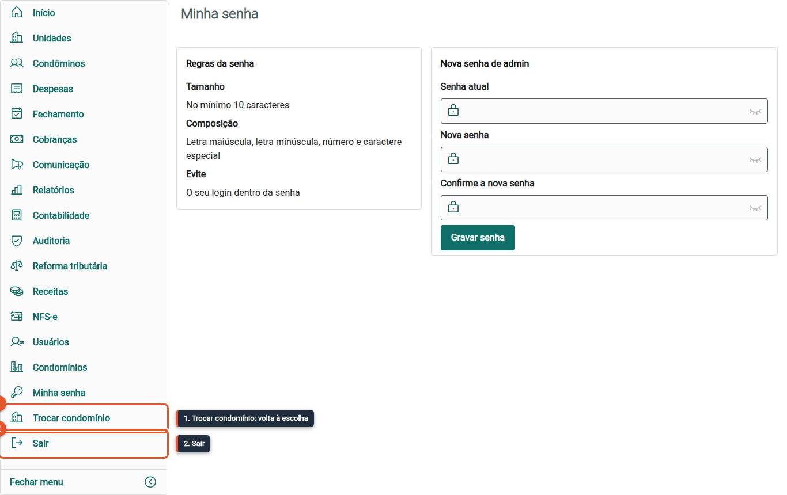

1. **Trocar condomínio** volta à escolha do condomínio (seção 2.1).
2. **Sair** encerra a sessão.

---

## 4. Cadastros

As telas de cadastro funcionam todas do mesmo jeito: **tabela** à esquerda,
**formulário** à direita.

- **Alterar**: clique na linha da tabela; os dados vão para o formulário;
  mude o que precisar e clique em **Gravar**.
- **Incluir**: clique em **Novo**, preencha e clique em **Gravar**.
- **Excluir**: clique na linha, clique em **Excluir** e confirme.

### 4.1 Condôminos

Cadastre os condôminos antes das unidades: cada unidade aponta para um
condômino.

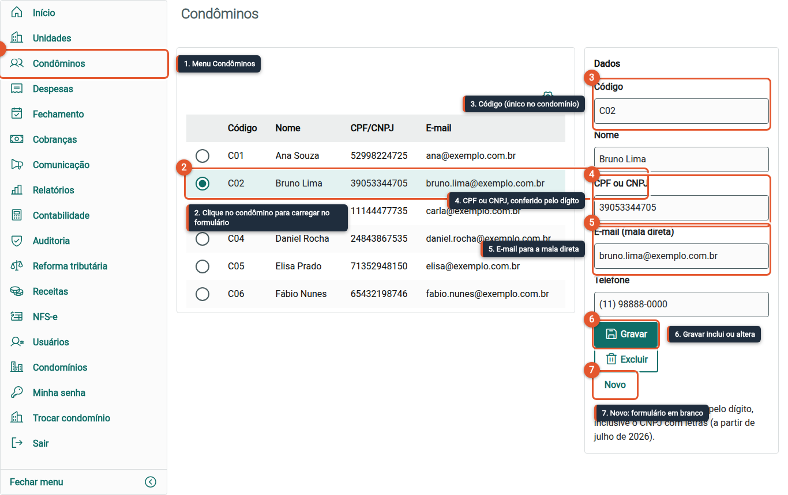

1. No menu, clique em **Condôminos**.
2. Clique no condômino na tabela, ou em **Novo** para incluir.
3. **Código**: um código curto e único no condomínio (por exemplo `C07`).
   É esse código que vai no cadastro da unidade.
4. **CPF ou CNPJ**: com ou sem pontuação. O GesCon confere o dígito
   verificador. O documento é obrigatório para emitir a NFS-e da cobrança.
5. **E-mail**: usado na mala direta.
6. Clique em **Gravar**.
7. **Novo** limpa o formulário para outro cadastro.

O **Nome** e o **Telefone** também ficam no formulário. Um condômino ligado
a uma unidade não pode ser excluído: primeiro troque o condômino da unidade.

### 4.2 Unidades

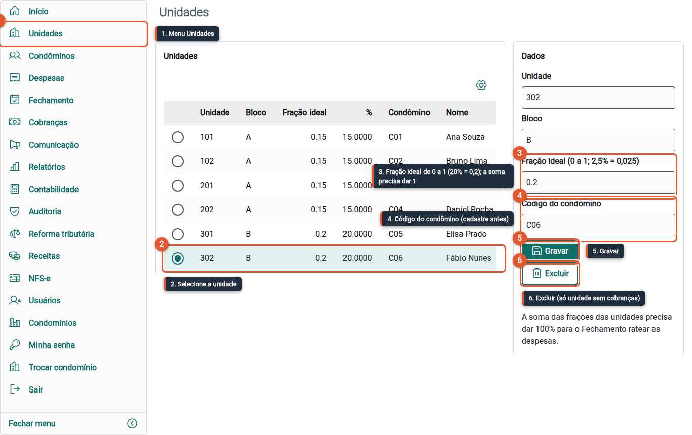

1. No menu, clique em **Unidades**.
2. Clique na unidade, ou em **Novo**.
3. **Fração ideal**: um número de 0 a 1. Por exemplo, 20% é `0,2` e 2,5% é
   `0,025` (aceita vírgula). **A soma das frações de todas as unidades
   precisa dar 1 (100%)**; o Início mostra a soma atual.
4. **Código do condômino**: o código cadastrado na seção 4.1.
5. Clique em **Gravar**.
6. **Excluir** só funciona em unidade sem cobranças, porque as cobranças são
   histórico.

O campo **Bloco** é opcional.

---

## 5. A rotina do mês

Todo mês o trabalho segue esta ordem:

1. lançar as **despesas** da competência;
2. **fechar** a competência, o que gera uma cobrança por unidade;
3. emitir e enviar os **boletos**;
4. registrar os **pagamentos**;
5. a partir de 01/01/2027, emitir a **NFS-e** das cobranças (seção 9.4).

### 5.1 Despesas

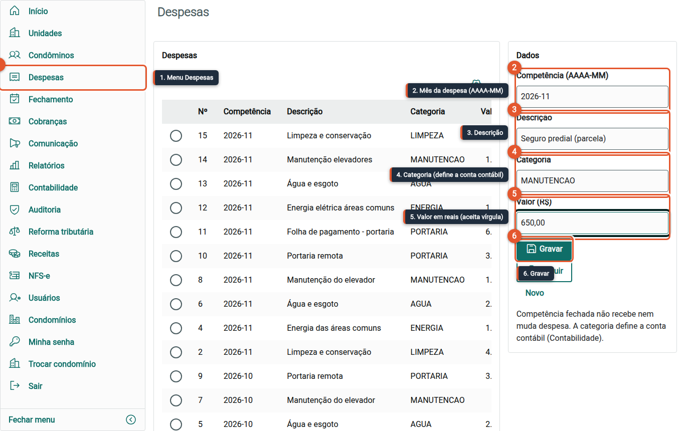

1. No menu, clique em **Despesas** e depois em **Novo**.
2. **Competência**: o mês da despesa, no formato `AAAA-MM` (por exemplo
   `2026-11`).
3. **Descrição**.
4. **Categoria**: por exemplo `PORTARIA`, `LIMPEZA`, `ENERGIA`. A categoria
   agrupa as despesas nos relatórios e define a conta contábil.
5. **Valor**: em reais, com vírgula (`650,00`).
6. Clique em **Gravar**.

Uma competência já fechada não recebe despesa nova nem aceita alteração.

### 5.2 Fechamento mensal

O fechamento soma as despesas da competência e reparte o total entre as
unidades pela fração ideal: **cobrança da unidade = total de despesas ×
fração ideal**.

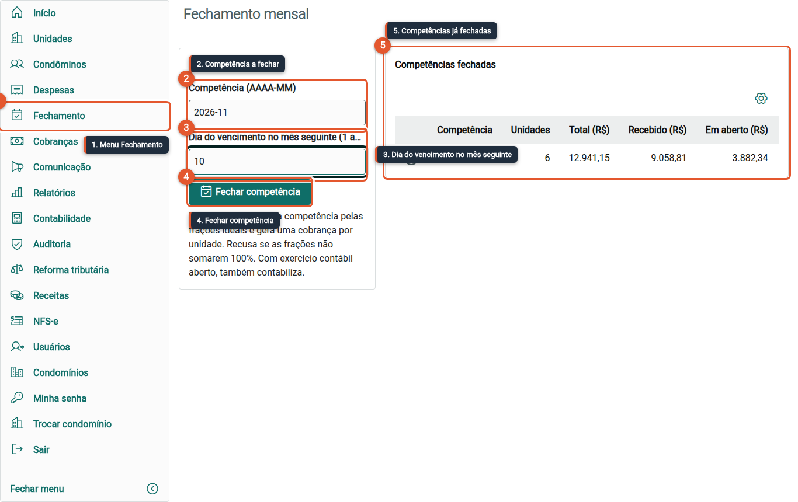

1. No menu, clique em **Fechamento**.
2. **Competência**: o mês a fechar (`AAAA-MM`).
3. **Dia do vencimento**: o dia, no mês seguinte, em que as cobranças
   vencem (de 1 a 28).
4. Clique em **Fechar competência**.
5. A tabela **Competências fechadas** mostra as competências já fechadas.

Se não houver exercício contábil aberto para a competência, o GesCon avisa
e pergunta se deve seguir:

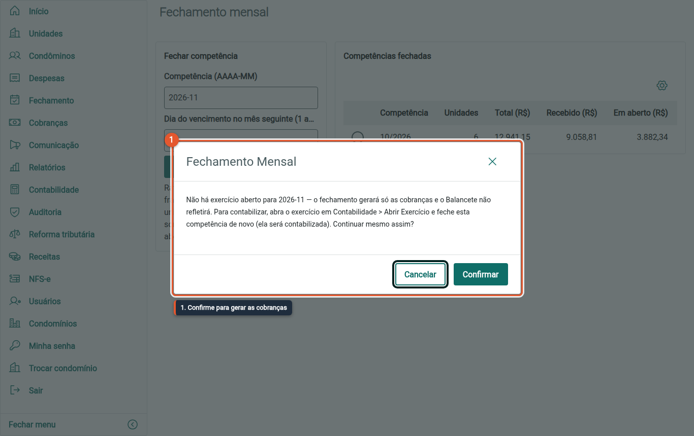

1. Clique em **Confirmar** para gerar as cobranças agora; a contabilização
   fica para quando você abrir o exercício (seção 8.3). Ou clique em
   **Cancelar**, abra o exercício e feche de novo.

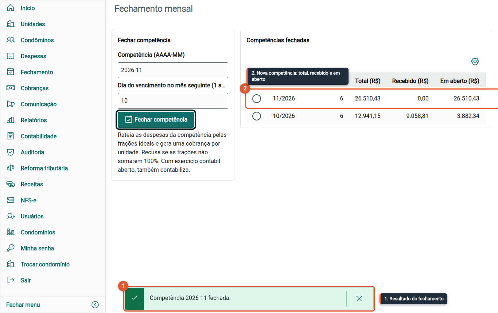

1. Confirmação do fechamento.
2. A competência aparece na tabela com o total cobrado, o recebido e o que
   está em aberto.

Regras do fechamento:

- O GesCon recusa o fechamento se as frações não somarem 100%.
- Cada competência é fechada uma vez só.
- As cobranças são gravadas todas juntas: ou todas as unidades são cobradas
  ou nenhuma.
- O centavo que sobrar da divisão vai para a unidade de maior fração.
- Mudar a fração de uma unidade depois do fechamento não muda a cobrança
  que já foi gerada.

### 5.3 Cobranças e pagamentos

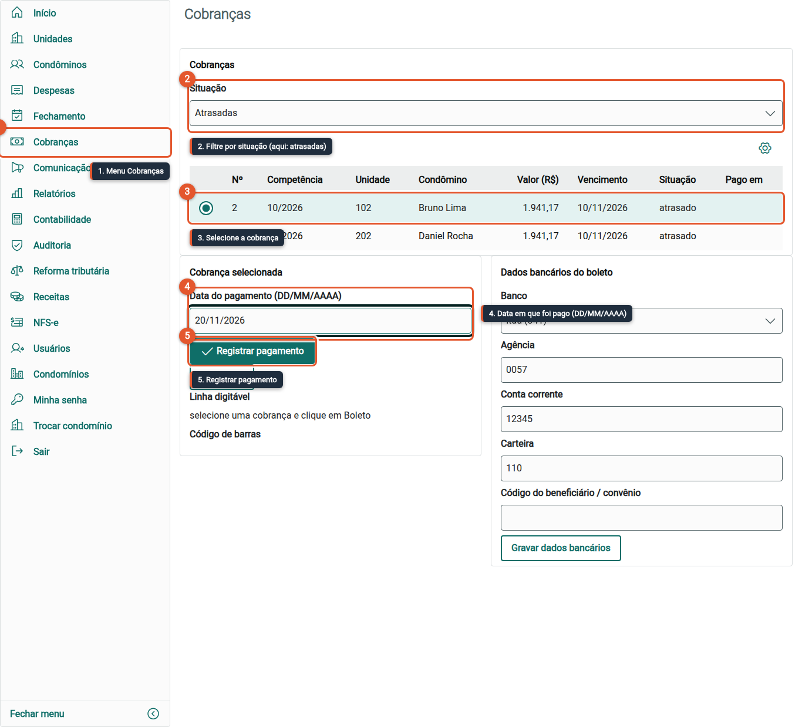

1. No menu, clique em **Cobranças**.
2. **Situação**: filtre por *Todas*, *Em aberto*, *Atrasadas* ou *Pagas*.
3. Clique na cobrança na tabela.
4. **Data do pagamento**: a data em que o condômino pagou, no formato
   `DD/MM/AAAA`. Não pode ser uma data futura.
5. Clique em **Registrar pagamento**.

Uma cobrança vencida e não paga passa sozinha para **atrasado**. Uma cobrança
já paga não é registrada de novo.

### 5.4 Boleto

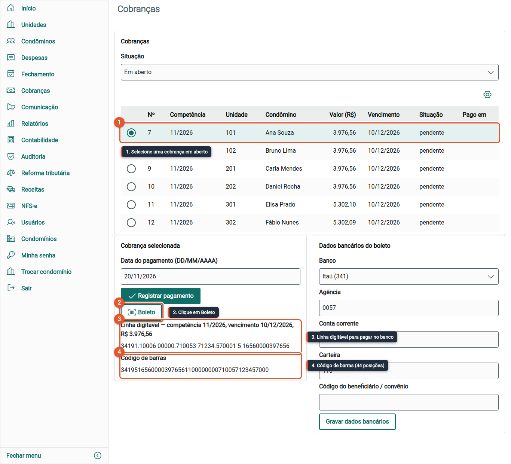

1. Clique numa cobrança em aberto.
2. Clique em **Boleto**.
3. **Linha digitável**: é o número que o condômino digita no banco ou no
   aplicativo para pagar.
4. **Código de barras**: as 44 posições do padrão FEBRABAN.

### 5.5 Dados bancários do boleto

Preencha uma vez, antes do primeiro boleto.

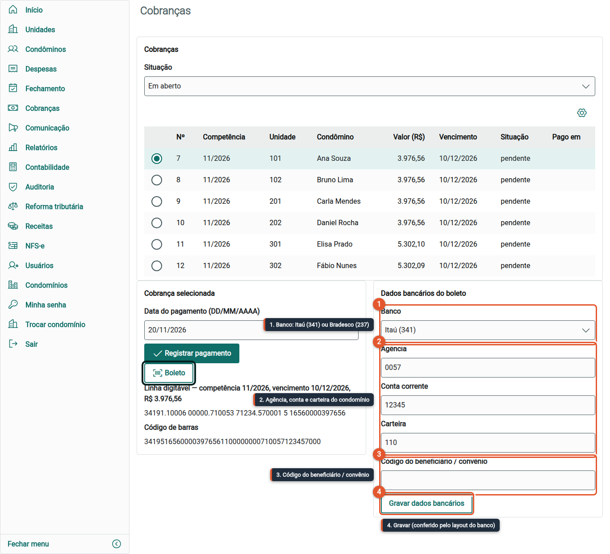

1. **Banco**: Itaú (341) ou Bradesco (237).
2. **Agência**, **Conta corrente** e **Carteira** da conta de cobrança do
   condomínio.
3. **Código do beneficiário / convênio**, fornecido pelo banco.
4. Clique em **Gravar dados bancários**. O GesCon confere os dados pelo
   formato que o banco exige e recusa o que estiver fora dele.

---

## 6. Comunicação

### 6.1 Avisos

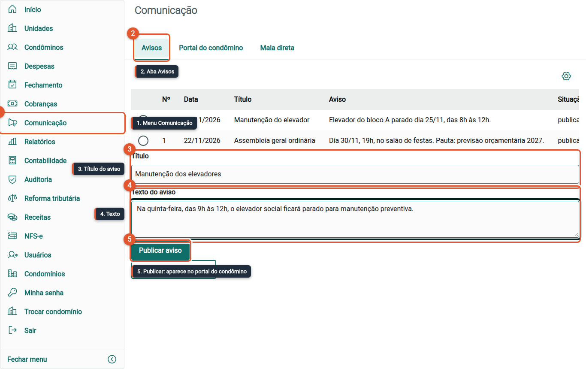

1. No menu, clique em **Comunicação**.
2. Fique na aba **Avisos**.
3. **Título** do aviso.
4. **Texto do aviso**.
5. Clique em **Publicar aviso**. O aviso aparece no portal do condômino.

Para tirar um aviso do portal, clique nele na tabela e depois em **Arquivar
o selecionado**.

### 6.2 Dar acesso ao condômino (token)

O condômino entra no portal com um *token*, um código que vale **uma vez**
e expira em **48 horas**.

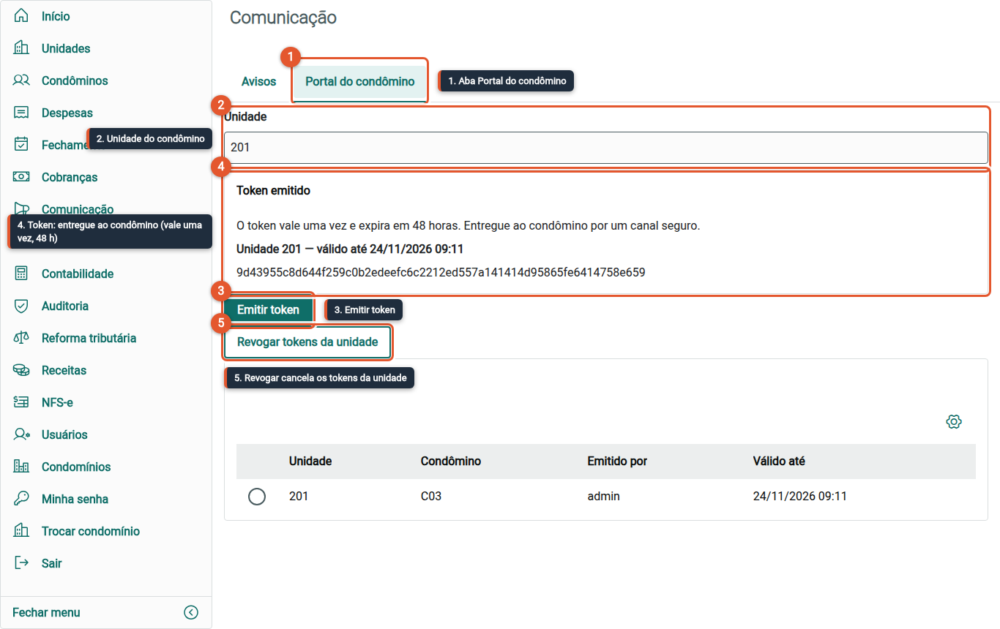

1. Abra a aba **Portal do condômino**.
2. **Unidade**: a unidade do condômino (ela precisa ter condômino
   cadastrado).
3. Clique em **Emitir token**.
4. O token aparece no quadro **Token emitido**, com a validade. Copie e
   entregue ao condômino **por um canal seguro**: quem tiver o token vê as
   cobranças da unidade.
5. **Revogar tokens da unidade** cancela os tokens ainda não usados.

A tabela **Tokens válidos** lista quem emitiu cada token e até quando vale,
sem mostrar o token em si.

### 6.3 Mala direta

Envia por e-mail, a cada condômino com e-mail cadastrado, a cobrança em
aberto da competência.

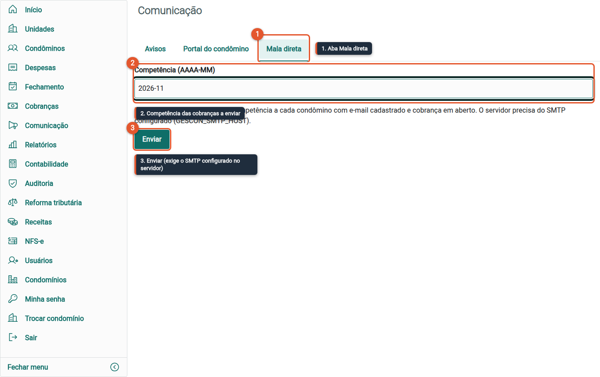

1. Abra a aba **Mala direta**.
2. **Competência**: o mês das cobranças a enviar.
3. Clique em **Enviar**. Para o envio funcionar, o servidor de e-mail
   (SMTP) precisa estar configurado (ver o Guia de utilização). Sem essa
   configuração, nenhum e-mail sai.

---

## 7. Relatórios

### 7.1 Inadimplência

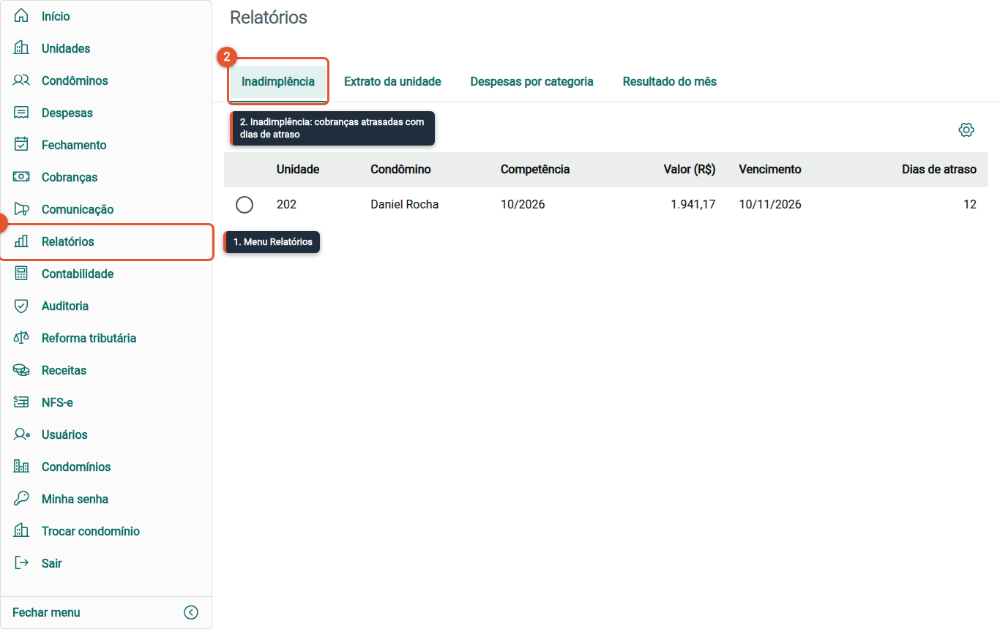

1. No menu, clique em **Relatórios**.
2. A aba **Inadimplência** abre direto: são as cobranças atrasadas, com os
   dias de atraso.

### 7.2 Extrato da unidade

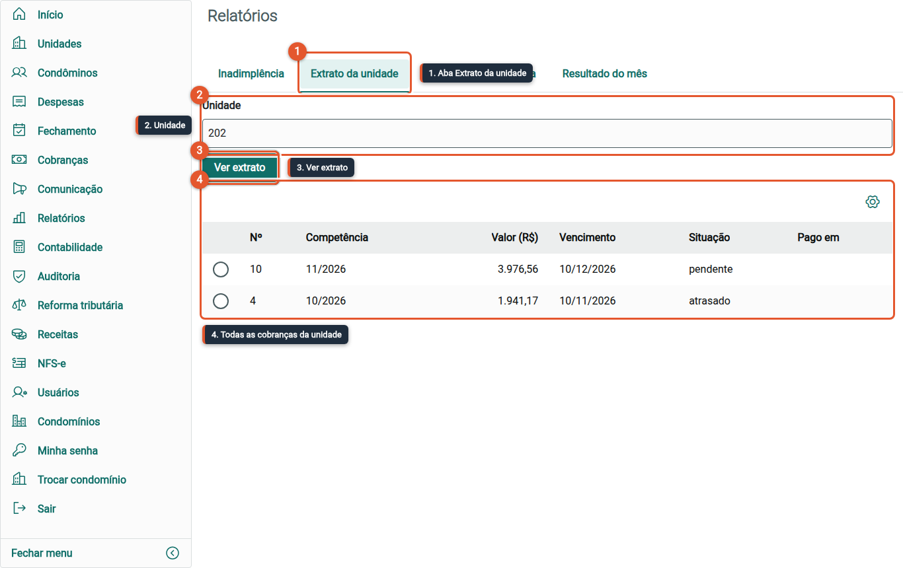

1. Abra a aba **Extrato da unidade**.
2. **Unidade**.
3. Clique em **Ver extrato**.
4. A tabela mostra todas as cobranças da unidade, com a situação e a data
   de pagamento.

### 7.3 Despesas por categoria

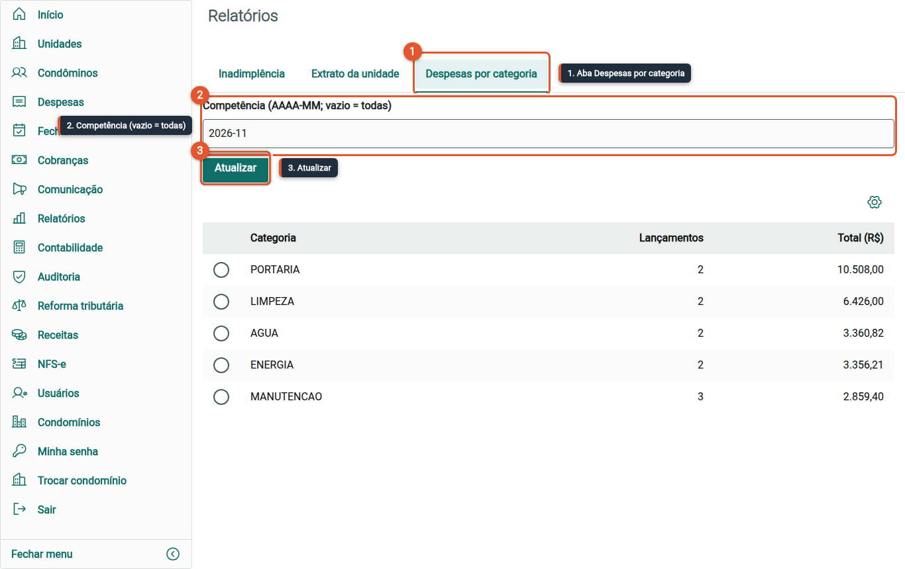

1. Abra a aba **Despesas por categoria**.
2. **Competência**. Se deixar o campo vazio, o relatório soma todas as
   competências.
3. Clique em **Atualizar**.

### 7.4 Resultado do mês

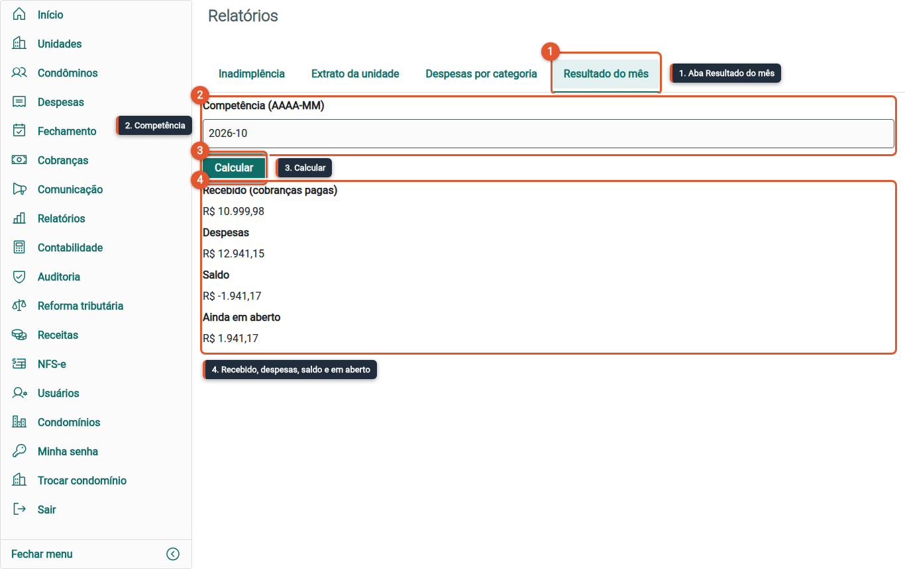

1. Abra a aba **Resultado do mês**.
2. **Competência**.
3. Clique em **Calcular**.
4. O GesCon mostra o **recebido** (cobranças pagas), as **despesas**, o
   **saldo** e o que **ainda está em aberto**.

---

## 8. Contabilidade e auditoria

O GesCon faz a contabilidade em partida dobrada: cada lançamento debita uma
conta e credita outra. O fechamento mensal já lança sozinho as despesas e o
rateio. Aqui você faz os lançamentos manuais e acompanha os saldos.

### 8.1 Lançamento manual

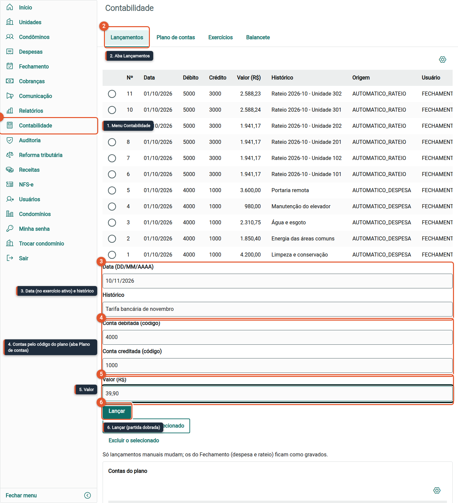

1. No menu, clique em **Contabilidade**.
2. Fique na aba **Lançamentos**. A tabela mostra os lançamentos do
   exercício ativo.
3. **Data**: precisa estar dentro do exercício ativo. Preencha também o
   **Histórico**, que descreve o lançamento.
4. **Conta debitada** e **Conta creditada**: os códigos das contas (veja a
   aba Plano de contas ou o quadro "Contas do plano"). As duas contas
   precisam ser diferentes.
5. **Valor**.
6. Clique em **Lançar**.

Só os lançamentos manuais podem mudar: para eles, use **Alterar histórico
do selecionado** ou **Excluir o selecionado**. Os lançamentos gerados pelo
fechamento ficam como foram gravados.

### 8.2 Plano de contas

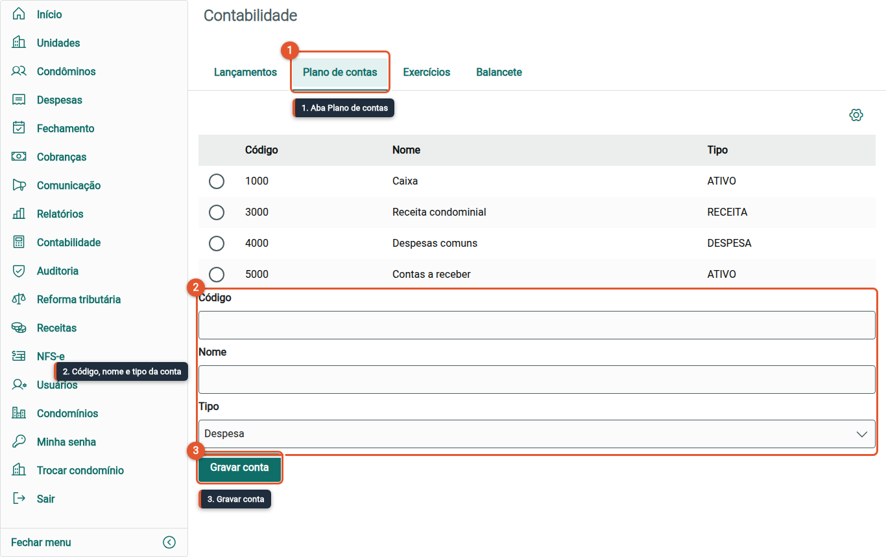

1. Abra a aba **Plano de contas**.
2. Preencha o **Código**, o **Nome** e o **Tipo**: Ativo, Passivo, Receita
   ou Despesa.
3. Clique em **Gravar conta**.

### 8.3 Exercícios

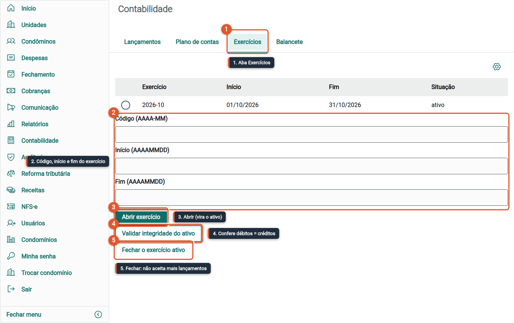

1. Abra a aba **Exercícios**.
2. Preencha o **Código** (`AAAA-MM`), o **Início** e o **Fim** (`AAAAMMDD`).
3. **Abrir exercício**: o exercício novo passa a ser o ativo. Só um
   exercício fica ativo por vez.
4. **Validar integridade do ativo**: confere se o total de débitos é igual
   ao de créditos.
5. **Fechar o exercício ativo**: depois de fechado, o exercício não aceita
   mais lançamentos. O GesCon pede confirmação.

### 8.4 Balancete

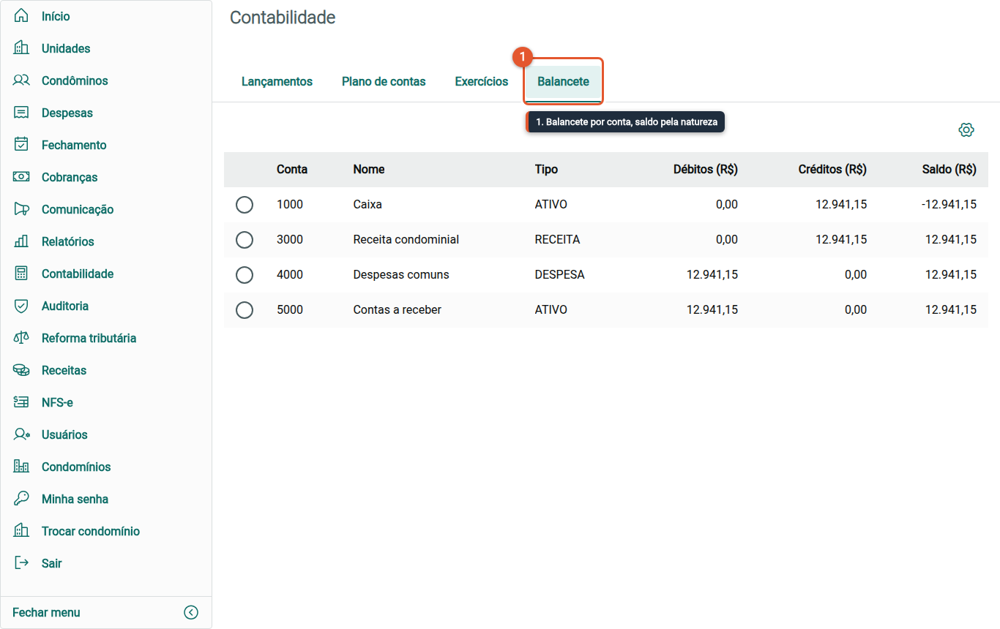

1. Abra a aba **Balancete**: débitos, créditos e saldo de cada conta. O
   saldo segue a natureza da conta: devedor para ativo e despesa, credor
   para passivo e receita.

### 8.5 Auditoria

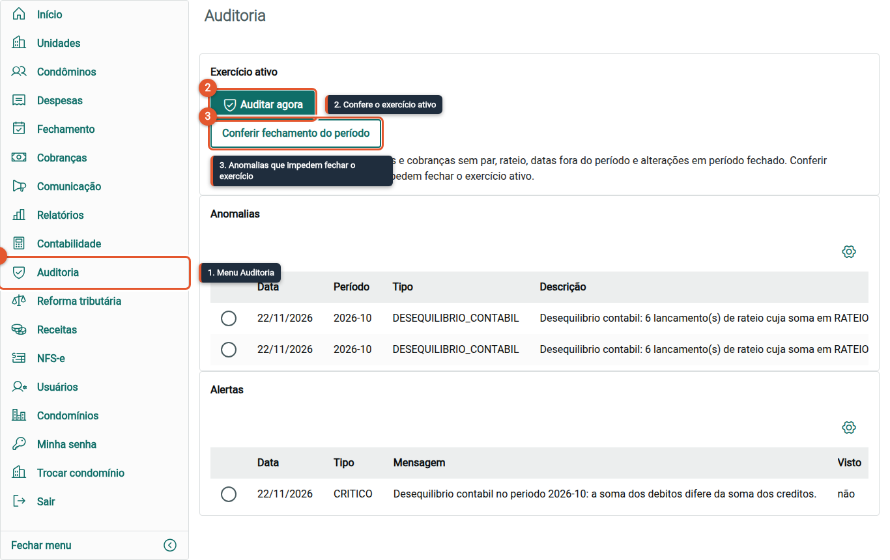

1. No menu, clique em **Auditoria**.
2. **Auditar agora** confere o exercício ativo: equilíbrio entre débitos e
   créditos, lançamentos e cobranças sem par, rateio, datas fora do período
   e alterações em período fechado. O resultado aparece em **Anomalias** e
   **Alertas**.
3. **Conferir fechamento do período** conta as anomalias críticas que
   impedem fechar o exercício.

---

## 9. Reforma tributária (IBS e CBS)

O que a lei diz, resumido:

- **Regra:** o condomínio edilício **não é contribuinte** do IBS e da CBS
  (LC 214/2025, art. 26).
- **Opção:** o condomínio pode **optar pelo regime regular**. Nesse caso
  paga IBS e CBS sobre todas as taxas e demais valores que cobra.
- **Teste dos 80%:** se não optar e o que cobra dos condôminos for **menos
  de 80%** da receita total, paga IBS e CBS sobre as receitas de terceiros.
- **NFS-e:** com ou sem imposto, **a NFS-e das cobranças é obrigatória a
  partir de 01/01/2027** (Ato Conjunto RFB/CGIBS nº 7/2026).

### 9.1 Dados fiscais do condomínio

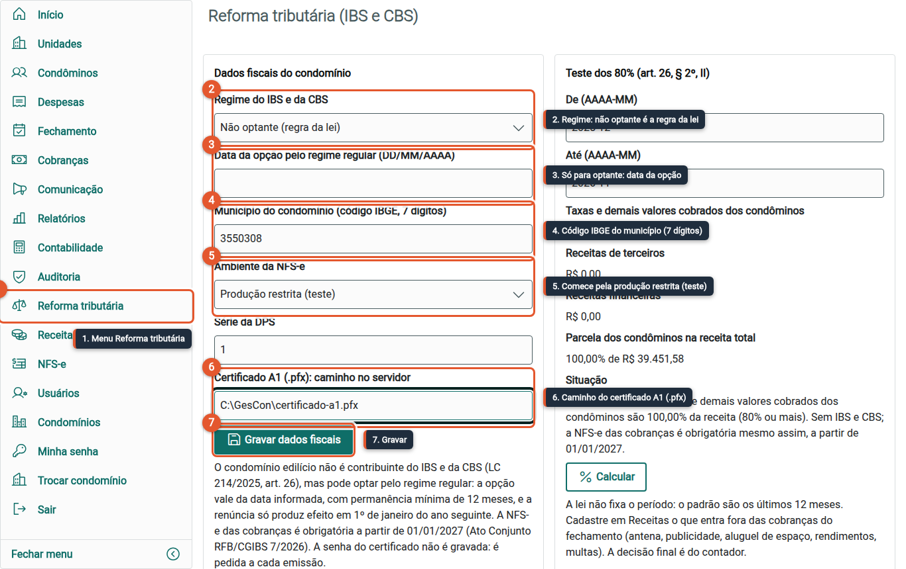

1. No menu, clique em **Reforma tributária**.
2. **Regime do IBS e da CBS**: deixe **Não optante**, que é a regra da lei,
   a menos que o condomínio tenha optado pelo regime regular.
3. **Data da opção**: só para optante. A opção exige **permanência mínima
   de 12 meses**, e a renúncia só vale a partir de 1º de janeiro do ano
   seguinte. O GesCon recusa renúncia antes disso.
4. **Município**: o código IBGE do município do condomínio, com 7 dígitos
   (São Paulo é `3550308`). O código pode ser consultado no site do IBGE.
5. **Ambiente da NFS-e**: comece em **Produção restrita (teste)**. Depois que
   uma nota de teste sair autorizada, passe para **Produção**.
6. **Certificado A1 (.pfx)**: o caminho do arquivo do certificado digital
   do condomínio no computador em que o GesCon roda (por exemplo
   `C:\GesCon\certificado-a1.pfx`).
7. Clique em **Gravar dados fiscais**.

A **série da DPS** pode ficar em `1`. A **senha do certificado não é
gravada**: o GesCon pede a senha em cada emissão.

### 9.2 Receitas fora do fechamento

O teste dos 80% considera tudo o que o condomínio recebe. Registre aqui o
que não vem das cobranças do fechamento.

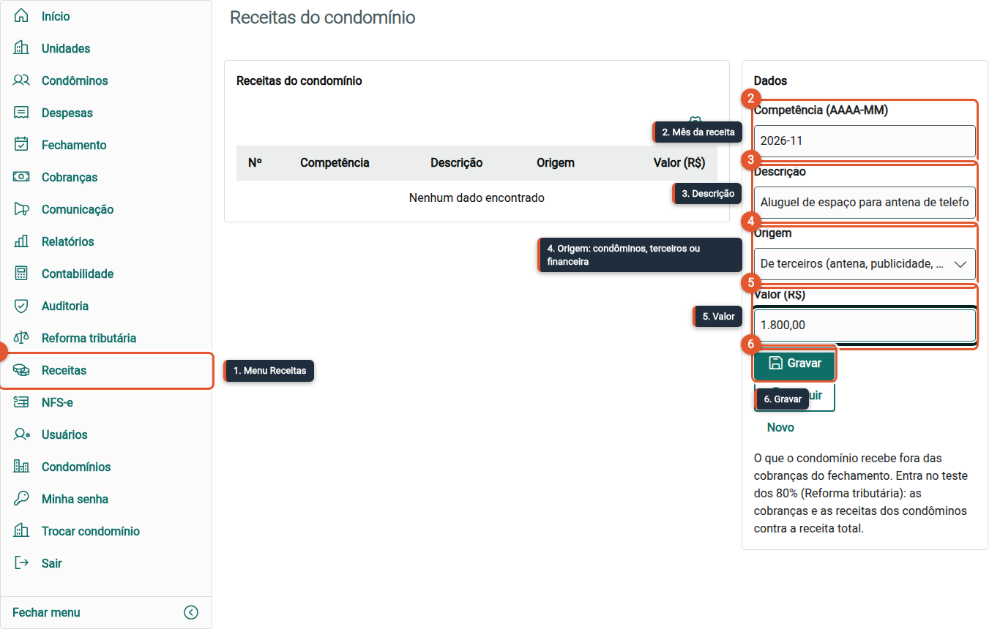

1. No menu, clique em **Receitas** e depois em **Novo**.
2. **Competência**.
3. **Descrição**.
4. **Origem**: **dos condôminos** (multa, reserva de salão), **de
   terceiros** (antena, publicidade, aluguel de espaço) ou **financeira**
   (rendimento de aplicação).
5. **Valor**.
6. Clique em **Gravar**.

### 9.3 Teste dos 80%

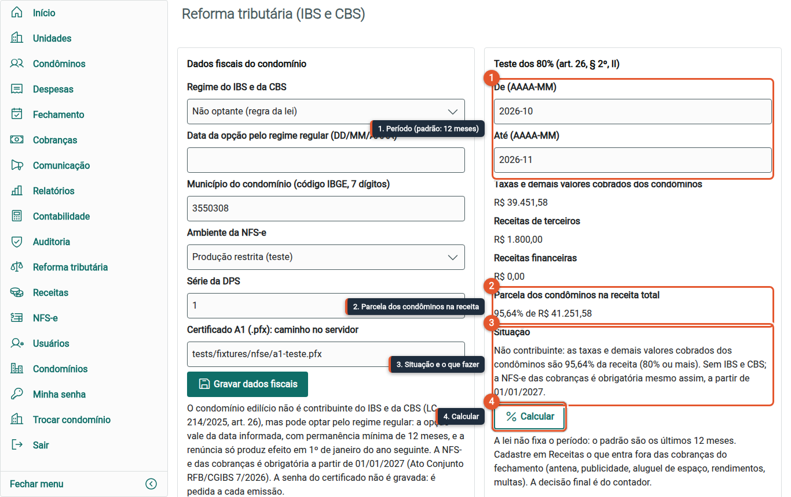

1. Informe o período em **De** e **Até**. Ao abrir a tela, o período já vem
   com os últimos 12 meses.
2. **Parcela dos condôminos na receita total**: as cobranças mais as
   receitas de origem "condôminos", divididas pela receita total.
3. **Situação**: o enquadramento e o que fazer. Abaixo de 80%, procure o
   contador.
4. Clique em **Calcular** para atualizar.

O GesCon não calcula o valor do IBS e da CBS: na NFS-e nacional, quem
calcula é a própria Receita, a partir da classificação da nota.

### 9.4 Emitir a NFS-e das cobranças

Antes da primeira emissão, confira se estão cadastrados:

- o **CNPJ do condomínio** (seção 3.1);
- o **município** e o **certificado A1** (seção 9.1);
- o **CPF ou CNPJ do condômino** de cada unidade (seção 4.1).

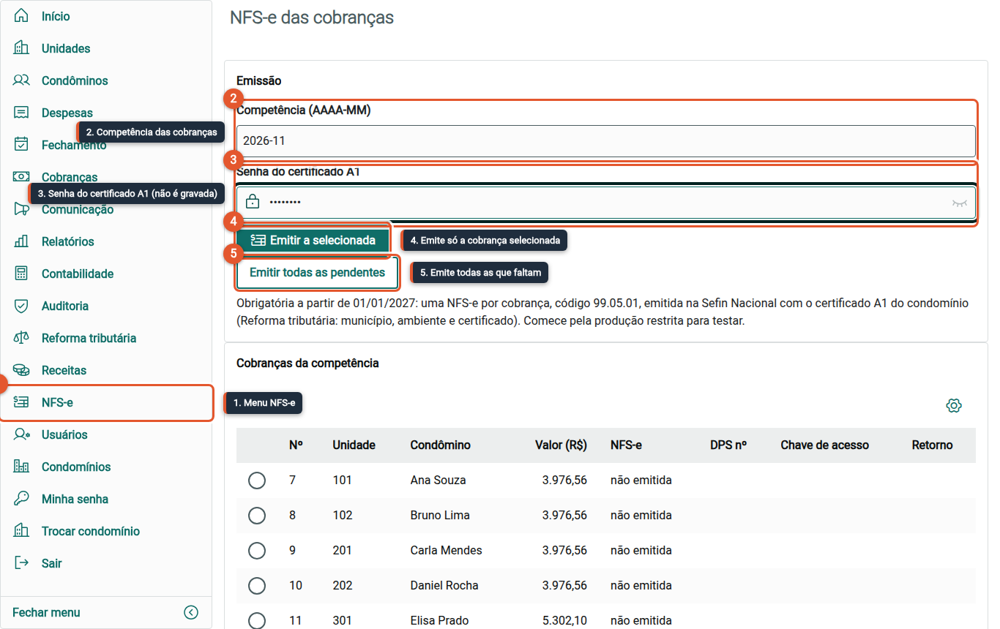

1. No menu, clique em **NFS-e**.
2. **Competência**: as cobranças desse mês aparecem na tabela.
3. **Senha do certificado A1**.
4. **Emitir a selecionada**: emite só a cobrança clicada na tabela.
5. **Emitir todas as pendentes**: emite todas as que ainda não têm nota
   autorizada.

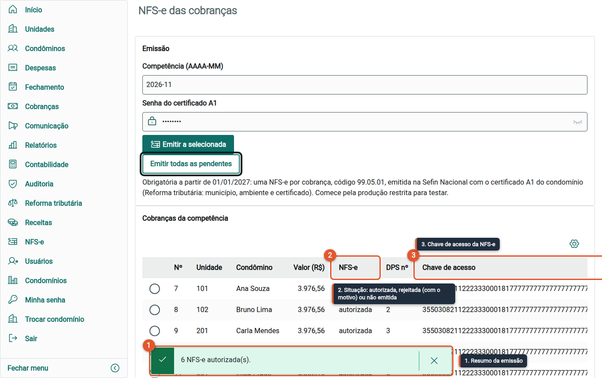

1. Resumo: quantas notas foram autorizadas e, se alguma não saiu, o
   primeiro motivo.
2. Coluna **NFS-e**: *autorizada*, *rejeitada* (o motivo aparece na coluna
   **Retorno**) ou *não emitida*.
3. **Chave de acesso** da nota autorizada.

Cada cobrança tem no máximo uma nota autorizada. Para corrigir uma nota
rejeitada, ajuste o cadastro e emita de novo; o GesCon reaproveita o mesmo
número. Uma senha errada não consome número de nota.

O GesCon emite a nota com o código nacional **99.05.01** (operações
condominiais). A classificação tributária segue o regime: não optante usa
CST 410 / cClassTrib 410012; optante usa CST 200 / cClassTrib 200046.

---

## 10. Portal do condômino

### 10.1 Entrar com o token

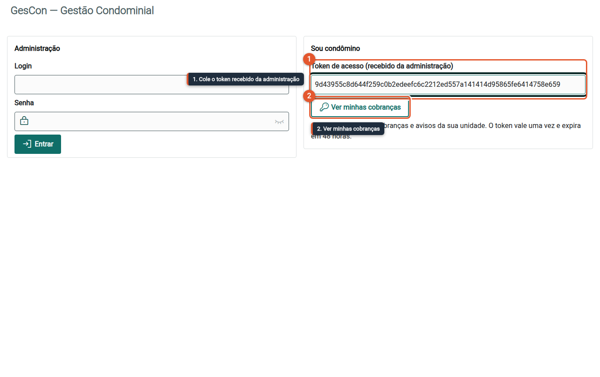

1. No quadro **Sou condômino**, cole o token recebido da administração.
2. Clique em **Ver minhas cobranças**.

### 10.2 Cobranças, boleto e avisos

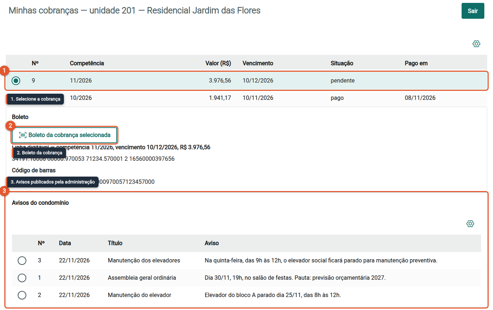

1. Clique na cobrança.
2. Clique em **Boleto da cobrança selecionada**: aparecem a linha digitável
   e o código de barras.
3. **Avisos do condomínio**: os avisos publicados pela administração.

O condômino só vê a própria unidade e não consegue gerar o boleto de outra.
O token vale **uma vez**: para entrar de novo, o condômino pede um token
novo à administração.

---

## 11. Roteiros completos

### 11.1 Implantar um condomínio novo

1. **Condomínios** → **Novo**: nome, CNPJ e endereço → **Gravar** (3.1).
2. **Trocar condomínio** → escolha o condomínio novo → **Abrir** (2.1).
3. **Usuários**: crie o síndico (3.2).
4. **Condôminos**: cadastre todos, com CPF/CNPJ e e-mail (4.1).
5. **Unidades**: cadastre todas, com a fração e o condômino. Confira no
   **Início** se as frações somam 100% (4.2).
6. **Cobranças** → **Dados bancários do boleto** (5.5).
7. **Contabilidade** → **Exercícios**: abra o exercício (8.3).
8. **Reforma tributária**: preencha os dados fiscais (9.1).

### 11.2 Fechar o mês

1. **Despesas**: lance todas as despesas da competência (5.1).
2. **Fechamento**: competência e dia do vencimento → **Fechar competência**
   (5.2).
3. **Cobranças**: gere os boletos ou use a **Mala direta** (5.4 e 6.3).
4. A partir de 2027, **NFS-e**: emita as notas da competência (9.4).
5. Durante o mês, registre os **pagamentos** à medida que entram (5.3).
6. **Relatórios**: confira a inadimplência e o resultado do mês (7).

### 11.3 Atender um condômino

- **Quer a segunda via do boleto**: emita um token na aba **Portal do
  condômino** (6.2), ou gere o boleto você mesmo em **Cobranças** (5.4).
- **Diz que já pagou**: confira em **Relatórios → Extrato da unidade** (7.2)
  e registre o pagamento em **Cobranças** (5.3).

---

## 12. Perguntas frequentes e mensagens

**"A soma das frações ideais das unidades é ... não 100%"**
Corrija as frações em **Unidades**. O **Início** mostra a soma atual.

**"Nenhum exercício ativo"**
Abra um exercício em **Contabilidade → Exercícios**.

**"Usuário bloqueado por excesso de tentativas"**
Espere 15 minutos ou peça a um administrador que clique em
**Desbloquear** na tela **Usuários**.

**Esqueci a senha**
Um administrador redefine a senha em **Usuários**. Se ninguém consegue
entrar, o responsável pelo servidor apaga os usuários do banco e define
`GESCON_ADMIN_SENHA` para recriar o `admin` (ver o Guia de utilização).

**"A competência ... já foi fechada"**
Despesa de mês fechado não entra nem muda. Lance a despesa na competência
seguinte.

**"A unidade ... precisa de condômino com CPF ou CNPJ válido para a NFS-e"**
Corrija o documento do condômino em **Condôminos** e emita de novo.

**"Não foi possível abrir o certificado A1"**
Confira o caminho do arquivo e a senha. Um certificado exportado pelo
OpenSSL 3, com cifra AES, precisa ser reexportado com
`openssl pkcs12 -export -legacy`. O certificado exportado pelo Windows
funciona.

**"NFS-e rejeitada: ..."**
O motivo vem da Sefin Nacional e aparece na coluna **Retorno**. Corrija
o cadastro e emita de novo; o GesCon reaproveita o número da nota.

**A página não abre ou caiu a sessão**
Recarregue a página. Depois de 30 minutos sem uso, é preciso entrar de
novo.
