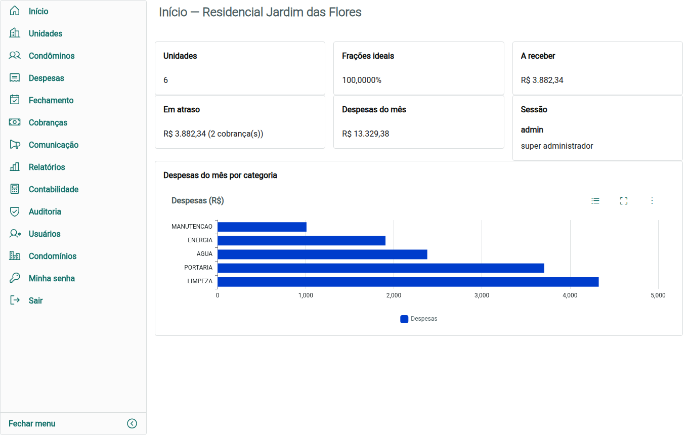

# GesCon — Sistema de Gestão Condominial

Gestão de condomínios para síndicos e administradoras: cadastro de unidades
e condôminos, despesas, fechamento mensal com rateio por fração ideal,
cobranças com boleto (Itaú e Bradesco), portal do condômino, mala direta,
relatórios, contabilidade em partida dobrada e auditoria. Vários condomínios
numa instalação, cada um com os dados separados.

Escrito em AdvPL/TLPP e executado pelo [AdvPP](https://github.com/peder1981/AdvPP)
(compilador e máquina virtual open-source). A interface é web, com
componentes PO-UI: abre no navegador, no computador do escritório ou num
servidor.



## Instalação

**Windows:** baixe `gescon-setup-<versão>.exe` da página de
[releases](https://github.com/peder1981/GesCon/releases) e instale (não pede
administrador). O atalho **GesCon** sobe o sistema e abre o navegador em
`http://127.0.0.1:8086`. Na primeira vez abre também o arquivo
`PRIMEIRO-ACESSO.txt` com a senha inicial do usuário `admin`; o primeiro
login pede uma senha nova.

**Linux e macOS:** baixe `GesCon-<versão>-<plataforma>.tar.gz`, descompacte e
rode `GesCon` de dentro da pasta.

Os dados ficam em `%LOCALAPPDATA%\GesCon` (Windows) ou
`~/.local/share/gescon` — faça cópia de segurança dessa pasta. Desinstalar o
programa não apaga os dados. O sistema só aceita conexões da própria máquina
(127.0.0.1).

**Servidor** (vários computadores ou acesso pela internet): ver
[`deploy/README.md`](deploy/README.md) e o
[Guia de utilização](GUIA_UTILIZACAO.md).

## O que tem

| Área | Faz |
|---|---|
| Unidades, condôminos, despesas | Cadastros validados: fração ideal entre 0 e 1, CPF/CNPJ pelo dígito (inclusive o CNPJ alfanumérico, a partir de julho de 2026), competência fechada não muda |
| Fechamento | Rateia as despesas da competência pelas frações (recusa se não somarem 100%) e gera uma cobrança por unidade; com exercício aberto, contabiliza |
| Cobranças | Filtro por situação, registro de pagamento, boleto (código de barras e linha digitável pelo padrão FEBRABAN) |
| Comunicação | Avisos, token de acesso ao portal (uso único, 48 h), mala direta por e-mail |
| Relatórios | Inadimplência com dias de atraso, extrato da unidade, despesas por categoria, resultado do mês |
| Contabilidade | Lançamentos manuais, plano de contas, exercícios, balancete por conta |
| Auditoria | Equilíbrio contábil, lançamentos e cobranças sem par, alterações em período fechado |
| Usuários | Super administrador (todos os condomínios) e síndico (os condomínios dele) |
| Portal do condômino | Cobranças, boleto e avisos da própria unidade, só leitura |

Segurança: senha em Argon2id com salt, política de senha, bloqueio após 5
erros, troca obrigatória no primeiro acesso, sessão encerrada após 30 minutos
sem uso, cada tela e operação conferida pelo perfil.

Telas: [Manual do usuário](MANUAL_USUARIO.md).

## Desenvolvimento

Requer o [`advplc`](https://github.com/peder1981/AdvPP) na versão fixada em
[`ADVPP_VERSION`](ADVPP_VERSION) (hoje **v4.8.6**; a CI, o release e o deploy
leem esse arquivo) e `sqlite3`.

```bash
scripts/bootstrap-db.sh                        # banco de desenvolvimento
GESCON_ADMIN_SENHA='Uma#SenhaForte1' ./gescon   # http://127.0.0.1:8086
scripts/test.sh                                # suíte (recusa outro advplc)
scripts/check.sh                               # sintaxe, alcance, isolamento por condomínio
packaging/build-package.sh 1.3.0               # pacotes e instalador em packaging/dist/
```

O GesCon usa do AdvPP 4.8.x: componentes PO-UI (`PoApp`), `.And.`/`.Or.` com
curto-circuito, conta de datas, `Transform` com picture `@E`, `UUIDRandom`,
`Argon2id`, `UPDATE ... RETURNING` via `TCSqlQuery` e, do 4.8.6, erro de SQL
devolvido ao programa (`TCSqlExec` = `.F.` + `TCSqlError()`).

Documentação técnica: [arquitetura](docs/ARQUITETURA.md),
[padrão de tela](docs/PADRAO_GUI.md), [funcional](docs/FUNCIONAL.md).

## Mala direta

Envia por e-mail a cobrança em aberto da competência a cada condômino com
e-mail cadastrado. Configuração no ambiente do servidor (no pacote, em
`gescon.env` na pasta de dados):

```bash
GESCON_SMTP_HOST=smtp.exemplo.com
GESCON_SMTP_PORT=587
GESCON_SMTP_USER=usuario
GESCON_SMTP_PASS=senha
GESCON_SMTP_FROM=gescon@seucondominio.com.br
```

Sem `GESCON_SMTP_HOST`, nada é enviado.

## Limitações conhecidas

- Boleto: Itaú (exceto carteiras de nosso número com 15 posições) e Bradesco;
  o arquivo de remessa CNAB ainda não é gerado.
- Taxa extra (cobrança fora do fechamento mensal) ainda não existe.
- Reforma tributária (IBS/CBS, NFS-e de condomínio a partir de 01/12/2026):
  em andamento.

## Agradecimentos

O GesCon é testado em campo por **Wilson Kraft**, cujos relatórios de QA
(`Wilson/`, resumidos no [CHANGELOG](CHANGELOG.md)) motivaram as versões
1.0.x–1.2.x. Obrigado, Wilson.
