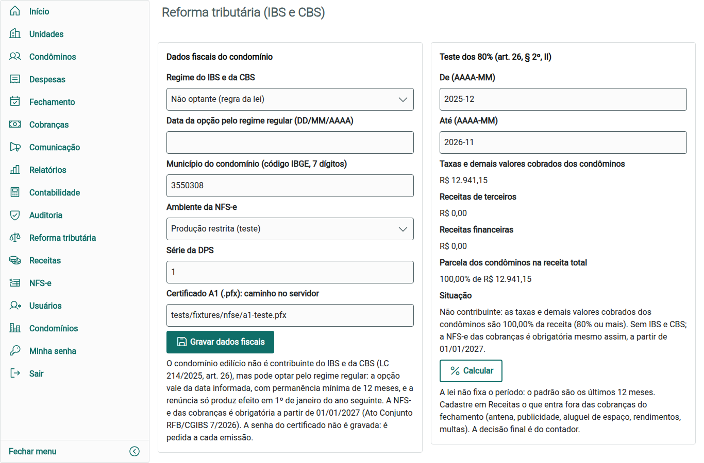

# Documentação funcional — GesCon

Regras de negócio. Como usar cada tela: [Manual do usuário](../MANUAL_USUARIO.md).

## Visão geral

Gestão de condomínios: cadastro de unidades e condôminos, despesas do mês,
fechamento mensal com rateio por fração ideal, cobranças e pagamentos,
boleto, portal do condômino, comunicação, relatórios, contabilidade e
auditoria. Uma instalação atende vários condomínios; cada um tem os dados
separados (filial) e cada usuário só abre os condomínios a que tem acesso.

## Acesso e perfis

- **Super administrador**: todos os condomínios; cadastra condomínios e
  cria outros super administradores.
- **Síndico**: os condomínios vinculados a ele; cria síndicos do condomínio
  aberto. Não cadastra condomínio nem cria super administrador.
- **Condômino**: entra com token (uso único, 48 horas) emitido pela
  administração; vê só cobranças, boleto e avisos da própria unidade.
- Login único, sem diferenciar maiúsculas. Senha com 10+ caracteres,
  maiúscula, minúscula, número e especial, sem o login; troca obrigatória no
  primeiro acesso e depois de redefinida; 5 erros seguidos bloqueiam por 15
  minutos; 30 minutos sem uso encerram a sessão.
- Instalação nova: o administrador `admin` só nasce com a senha inicial de
  `GESCON_ADMIN_SENHA` (o pacote gera sozinho); não há senha padrão.

## Cadastros

- **Unidade**: código (até 10 letras, números, hífen ou barra), bloco,
  fração ideal (maior que 0, até 1) e condômino (precisa existir). Unidade
  com cobranças não é excluída.
- **Condômino**: código, nome, CPF/CNPJ (conferido pelo dígito; aceita o
  CNPJ alfanumérico da Receita, a partir de julho de 2026), e-mail (validado,
  usado na mala direta) e telefone. Condômino vinculado a unidade não é
  excluído.
- **Despesa**: competência `AAAA-MM`, descrição, categoria (define a conta
  contábil) e valor maior que zero, arredondado a 2 casas. Competência já
  fechada não recebe nem muda despesa.

## Fechamento mensal

Dada a competência, soma as despesas e gera uma cobrança por unidade:

```
cobrança da unidade = total de despesas da competência × fração ideal da unidade
```

- **Recusa** se a soma das frações ideais não estiver entre 99,9% e 100,1%,
  ou se a competência não estiver em `AAAA-MM`.
- **Uma vez por competência**: uma competência com cobranças não é fechada de
  novo (índice único por condomínio, competência e unidade). Exceção: se foi
  fechada sem exercício aberto e o exercício foi aberto depois, fechar de
  novo contabiliza (só os lançamentos).
- **Tudo ou nada**: as cobranças são gravadas num único comando; se falhar,
  nenhuma unidade é cobrada.
- **Soma exata**: o centavo que sobrar do rateio vai para a unidade de maior
  fração.
- **Valor travado**: mudar a fração depois não recalcula cobrança gerada.
- **Vencimento**: no mês seguinte, no dia escolhido (1 a 28; fora disso, 10).
- **Sem exercício aberto**: pergunta antes; as cobranças saem, a
  contabilização fica para depois.

## Pagamento e boleto

- Pagamento com data válida e não futura; cobrança já paga não é regravada.
- Cobrança vencida e não paga passa a "atrasado" (ao entrar e ao abrir os
  relatórios).
- Boleto: Itaú e Bradesco, padrão FEBRABAN (fator de vencimento com reinício
  em 22/02/2025), nosso número = número da cobrança; não sai para cobrança
  paga. Dados bancários conferidos pelo layout do banco ao gravar.

## Comunicação

- **Avisos**: publicados aparecem no portal do condômino; arquivados somem
  de lá.
- **Mala direta**: um e-mail por condômino com e-mail válido e cobrança em
  aberto na competência, com valor em reais e vencimento em DD/MM/AAAA.
  Exige SMTP configurado no servidor.

## Relatórios

Inadimplência (cobranças atrasadas com dias de atraso), extrato da unidade,
despesas por categoria e resultado do mês (recebido, despesas, saldo, em
aberto). Sempre do condomínio aberto, calculados na hora.

## Contabilidade

- Exercício (`AAAA-MM`, início e fim válidos); um ativo por vez.
- Lançamento manual em partida dobrada: data dentro do exercício ativo
  aberto, contas existentes e diferentes, valor maior que zero, histórico.
  Grava o login de quem lançou. Só lançamentos manuais podem ser alterados
  ou excluídos.
- Balancete por conta: ativo e despesa com saldo devedor (débito − crédito);
  passivo e receita com saldo credor.
- Fechar o exercício impede novos lançamentos nele.

## Reforma tributária



- **Regime**: o condomínio edilício não é contribuinte do IBS e da CBS (LC
  214/2025, art. 26, I). Pode optar pelo regime regular: a opção vale da
  data informada; a renúncia só é aceita depois de 12 meses de opção e o
  condomínio continua optante até 31/12 do ano da renúncia (Decreto
  12.955/2026, art. 25).
- **Teste dos 80%** (art. 26, § 2º, II): numerador = cobranças do fechamento
  + receitas de origem "condôminos"; denominador = tudo (inclusive
  terceiros e financeiras). 80% ou mais: sem IBS e CBS. Menos de 80%, não
  optante: IBS e CBS sobre as operações que o condomínio realizar, com
  crédito proporcional — o GesCon avisa e não calcula: é para o contador.
  Optante: IBS e CBS sobre todas as taxas e demais valores.
- **NFS-e** (Decreto 12.955/2026, art. 115, VI, "d"; a partir de 01/01/2027
  pelo Ato Conjunto RFB/CGIBS 7/2026): uma por cobrança, emitida na Sefin
  Nacional com o certificado A1 do condomínio. Código 99.05.01, NBS
  1.1001.90.00, local do imóvel (cIndOp 020201), ISSQN não incide, grupo
  `condominios` com vencimento original e a cobrança (tipo 01, condomínio
  ordinário). Não optante: CST 410 / cClassTrib 410012; optante: CST 200 /
  cClassTrib 200046. A Sefin calcula o IBS e a CBS.
- Exige: CNPJ do condomínio (Condomínios), município, certificado, e CPF ou
  CNPJ válido do condômino de cada unidade. Cobrança com NFS-e autorizada
  não é emitida de novo.

## Limitações conhecidas

- Taxa extra (cobrança fora do fechamento mensal): fora da interface até a
  cobrança ter tipo próprio (o caminho antigo gerava vencimento em 31/02 e
  colidia com a regra de uma cobrança por unidade e competência).
- Repartição só por fração ideal.
- Boleto sem arquivo de remessa CNAB; Itaú sem as carteiras de nosso número
  com 15 posições.
- NFS-e: só emissão. Cancelamento e substituição (eventos), detalhamento
  da cobrança por tipo (gDetCobranca) e descontos ainda não existem.
- O XSD oficial publicado (produção restrita, 20/10/2026) ainda não traz o
  grupo `condominios` da NT 009: o GesCon segue a NT; quando sair o XSD
  definitivo, conferir (`tests/fixtures/nfse`).
- O nome do campo do envio (`dpsXmlGZipB64`) não está no manual público da
  API (a documentação Swagger exige certificado); vem de integradores.
  Primeira emissão real deve ser feita na produção restrita.
